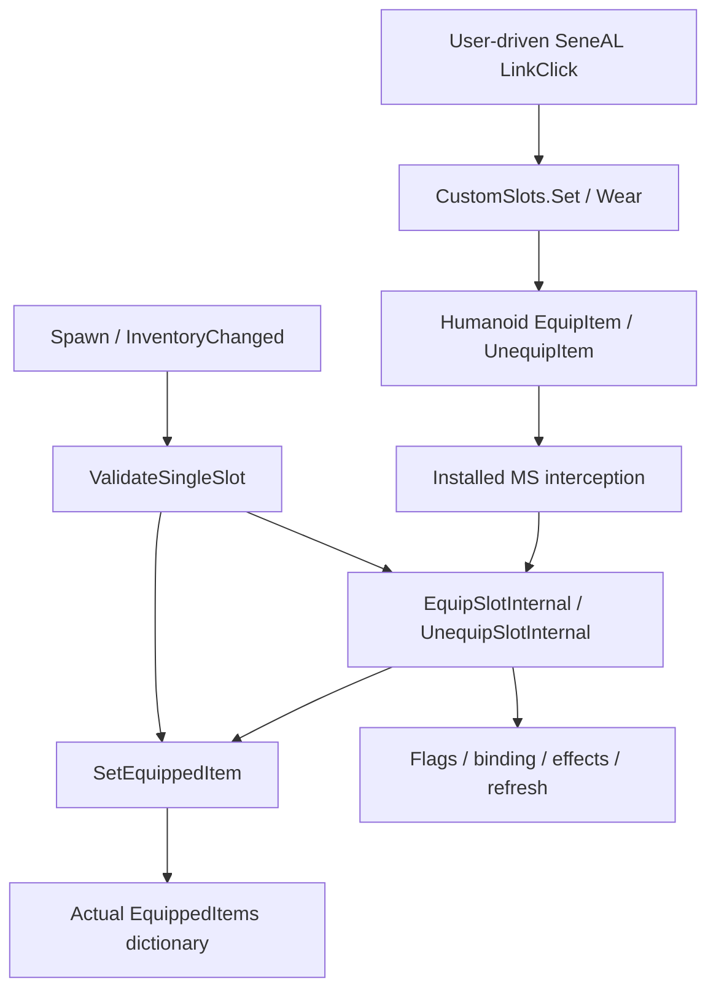

# Independent Tome transition evidence architecture

## Decision and boundary

**Recommendation A: proceed to a narrowly scoped offline proof of concept, under a separate
implementation task.** Investigate game-driven provenance with captured-root corroboration.
No proof of concept, observer extension, patch, event subscriber or gameplay change was
implemented here. C1 equipment testing remains blocked; neutral certification remains Unknown.
DEV-007 closed the direct static-read observer approach. This separate proposed architecture
does not reopen or expand that observer, and does not supersede its safety findings.

This differs from the refused static-store reads in [[DEV-007-C1-ownership-audit]]: a hook could
receive the actual data object returned by a **game-initiated** MS GetRuntimeData call, then
read its already-existing instance dictionary. It must never call that creating getter itself.
Installed IL establishes the returned object's source; non-interfering interception, initial
settling and independent corroboration are unproved. Those are the first proposed PoC gates.

Preserved baseline: main d29b5e560eacdc32e740e00fe0be2524fd4bf199; the25 existing working-tree
files were preserved. This task adds design/evidence only. No runtime permission follows.

## Seven distinct claims

| Claim | Required evidence; what it does not establish |
|---|---|
| Eligibility | Accepted descriptor/internal predicate for the exact item; Stage B proved canonical-prefab acceptance, not an equipment transition |
| Attempt | A real game/UI call entered; it can be rejected, skipped, interrupted or a no-op |
| Completed operation | Audited operation reached completion without exception and postconditions hold; a return value alone is insufficient |
| Authoritative ownership | Exact player's actual MS ownership dictionary references the exact ItemData in tome; no inference from UI or flags |
| Ownership/flags consistency | Correlated owner references, main/custom inventories and flags for the same instances; agreement between derived projections is not independent corroboration |
| Persistent binding | Distinguish current m_customData key, serialized package and successfully restored state; no one stage proves durable storage |
| Safe neutral state | Full predicate from DEV-007/EXP-004, including other owners, item conservation, effects, evidence continuity and neutral save/reload under bridge On; no automatic rollback |

## A. Actual installed transition topology

All addresses are hexadecimal metadata tokens, scoped to these exact installed images. Absolute
paths are under S:\Valheim-Modding\PoVPlus-Dev\; image names/versions are PE metadata identities.

| Image/version | Relative path | SHA-256 |
|---|---|---|
| Magic_Supremacy3.1.5.0 | BepInEx/plugins/Dreanegade-Magic_Supremacy/Magic_Supremacy.dll | 8BAFE7DAEFB9B6AF057FC3B10534764ED9CCEBA430B526A014B2DD12CFABA787 |
| SeneaL-UI0.1.0.0 | BepInEx/plugins/seneaL-SeneaL_UI/SeneaL-UI/SeneaL-UI.dll | 53B0F675BFFD0BAC5FCCA711AF04AA1EF00BB5BECD543D702EBAA146E5C487CD |
| SeneaL-API1.0.0.0 | BepInEx/plugins/seneaL-SeneaL_API/SeneaL-API/SeneaL-API.dll | 2EF9EB8DD3AB7DC72E7F3A908EFF843C4C7FAD19570CB46C3565BC36841E3574 |
| PathOfValheiman1.0.0.0 | BepInEx/plugins/treextr-PathOfValheiman/PathOfValheiman/PathOfValheiman.dll | 83BD50F23D9C301FE469B5FBE2C430FD35C928D7A2CCFD99AF5A1040558C9D72 |
| assembly_valheim0.0.0.0 | valheim_Data/Managed/assembly_valheim.dll | 94998885B103D6E5F5480123EAEE0A093E82AF2DDEEEE37536C15BF555F24F3A |

Verified source policy remains the existing two-gate, default-Off bridge; its production files
are unchanged. Native and eligible BMP books route through the same MS mutation machinery
**if** the bridge permits their matching definition. This is code-derived topology, not a
runtime equipment success claim.



| Boundary / real calls | Installed evidence / success and failure distinctions |
|---|---|
| UI LinkClick06000b6e -> API Set060001f7 -> Wear060001f9 | API StubHost.Emulate06000032 sets Linked mode2 at01c7, Source01f0/Accepts0203, without Put/Take setters, and registers AzuEPI.emulated at026b. Drag path checks Allows and main-list membership before Set; empty click calls Set(null). Wear invokes Put/Take delegates if later supplied, otherwise Humanoid.UnequipItem060001ed / EquipItem060001ec. Source failure can become null. These are routing/attempt boundaries, not ownership commits |
| MS Humanoid_EquipItem_CustomSlots Prefix0600047a / Postfix0600047b | Prefix resolves matching IsValid definition and temporarily sets shared ItemType727 at IL0056 before the base body. Postfix restores type at003a, calls EquipSlotInternal at0049, then writes __result=true at0050. Original false is not by itself final MS failure; an exception can interrupt before restoration. No MS equip finalizer is declared on this patch class; other runtime interception is unverified |
| EquipSlotInternal0600046f | Existing same item -> early no-op. Swap calls UnequipSlotInternal0049 first. Then SetEquippedItem0056 -> flag true005d -> GetOrCreateItemGuid006d -> SetSavedEquippedGuid0076 -> ApplyStatusEffect007d -> RefreshEquipment0083. Failure can follow ownership publication; normal setter return does not certify effect/binding completion |
| MS Humanoid_UnequipItem_CustomSlots Prefix0600047c | Searches current map by reference. Calls UnequipSlotInternal005a and returns false to skip original when handled; a normal Humanoid void return is not an independent success indication. No matching entry takes a different path |
| UnequipSlotInternal0600046e | RemoveStatusEffect0012 -> flag false0019 -> SetEquippedItem(null)0026 -> ClearSavedEquippedGuid0037 -> visual/refresh/optional effect. These are separate operations; an exception can leave partial state |
| SetEquippedItem0600045a | Existing game GetRuntimeData -> EquippedItems.Remove at0023 or dictionary.set_Item at0032. This is the narrow MS map mutation boundary. It also has invalid-input early returns. It neither proves full transaction completion nor covers other frameworks' ownership |
| ValidateSingleSlot06000472 | Called by RestoreOrValidateCustomSlots06000471. It can unequip004b, directly clear owner0090/binding0097, or directly restore owner00da/flag00e1/effect00e8 without EquipSlotInternal. Therefore patching only equip/unequip helpers misses restoration writes |
| OnInventoryChanged / OnSpawned | Installed MS postfixes06000480/481 invoke RestoreOrValidateCustomSlots, subject to owner/player/loading guards. Inventory changes and spawn can mutate ownership without an explicit player equip request. These callbacks perform validation, not passive notifications |
| Binding and serialization | SetSavedEquippedGuid06000465 creates a dictionary if missing then writes its key; ClearSavedEquippedGuid06000466 removes it. PlayerProfile.SavePlayerData060017c2 -> Player.Save060002dd serializes inventory at0057 and custom-data entries around038a onward; LoadPlayerData060017c3 -> Player.Load060002de restores both, then spawn validation reconstructs MS ownership. Package creation is not a disk/cloud save acknowledgment |
| Utility/Belt competing authority | PoV BeltSlot.Put0600028c and Take0600028d alter a separate weak-table ownership entry and m_equipped; declared Hum_Equip/Unequip prefixes0600302d/302e can intercept Humanoid operations. SeneAL ExtraSlotPatches also intercept equip/unequip. Their results cannot be inferred from the MS setter ledger |

Declared priorities in installed metadata: MS equip postfix800; PoV Belt prefixes600;
SeneAL ExtraSlot equip/unequip prefixes800. MS equip/unequip patches and spawn/inventory
postfixes are explicitly declared. Metadata is not a live ordering trace: prefix skipping,
postfix interactions, inlining, dynamically installed patches and other modpack handlers remain
runtime prerequisites. Existing bridge postfixes change only acceptance gates, not these writes.

The inspected MS map consumers access EquippedItems through GetRuntimeData; RuntimeData and
EquippedItems fields are initonly references (not deeply immutable). This supports a bounded
map-root model for that pinned image, not a closed-world guarantee against reflection writers,
replaced returns or external mods. A whole-transaction ledger must also distinguish nested swaps,
restore validation, death/drop paths and asynchronous SeneAL respawn callers. No inspected MS
helper body is an async state machine, but callers/callbacks can run later or re-enter.

## B. Architecture comparison

| Approach | Feasibility / proof obligations | Risks, blind spots, cost and cleanup capability |
|---|---|---|
| A: transition ledger alone | Conditional: instrument actual MS setter and enclosing transactions, including restore; begin/end/fault records must be paired | Entry/success-only records miss early no-ops and partial writes; missing hooks can be silent. Medium patch/order cost, O(1) bounded records. Cannot prove initial or neutral state alone |
| B: existing events/callbacks | Verified API CustomSlots.Changed / SlotDef.Changed exist; Report060001fc dispatches them. But linked Poll060001fb samples Source and compares Entry.Seen before reporting | No every-transition guarantee. Occupied->empty->occupied between polls can disappear; direct map writes need not alter Source. Subscription can initialize a static holder and adds a reentrant callback. Low instrumentation, inadequate authority/rollback evidence |
| C: independent state corroboration | Existing instance flags/main list/binding/effects can be read under DEV-007 conditions. Game-returned MS data could supply a real map root without a static read | Conditional root acquisition and coherent snapshots; no unsafe getters may be called for a check. UI is derived from flags, custom/Belt/provider state remains incomplete. Medium bounded checkpoint cost; stronger than logs alone but insufficient alone for neutral certification |
| D: disposable isolation/recovery | Can reduce consequences if an independently verified separate profile/machine/VM has no shared production saves or cloud synchronization and a tested recovery copy | Isolation is not ownership proof. Names and -savedir are insufficient in this installation. Setup/restore requires later explicit approval; no backup/saves/profile changes now. High operational cost but protects against an uncertain equipped-item recovery |

**Recommended candidate: A+C, game-driven provenance with captured-root corroboration.** This
is one bounded diagnostic design, not another equipment registry. It records facts about MS
state and never participates in acceptance or equipment decisions. D is a future safety
prerequisite for adverse recovery, not an instrumentation feature or substitute for proof.

## C. Captured-root design and independent evidence

Proposed witness: observe the return of an actual game-initiated GetRuntimeData06000453. Its
IL0000 reads RuntimeData, IL0006 invokes GetOrCreateValue and IL000b returns the actual
HumanoidCustomSlotData. Any creation was requested by the existing game/mod operation, not
by diagnostic code. A valid returned object therefore offers an instance root to EquippedItems.
No additional call to GetRuntimeData/GetEquippedItem, no static reflection, no registry creation
or equipment method invocation is permitted. Missing natural calls leave the observer inert.

This bootstrap is **conditional**, not yet a verified non-interfering implementation. It must
prove original execution, audited unmodified return provenance, exact authorized humanoid/session,
and absence of unexpected patch owners/return replacement. A readonly field is not proof the
dictionary never changes. A new player/data object, lost weak reference, changed owner/contract,
late instrumentation or unknown patch invalidates the evidence epoch. Avoid extending lifetimes
of game objects; weak-reference/lifetime behavior must be tested, not assumed harmless.

Two channels are proposed:

1. Immutable sequence/transaction records from actual setter/enclosing equip, unequip and restore
   calls: identity epoch, item-reference alias, slot, parent/depth, entry/completion/fault and
   monotonic sequence. Never interpret an entry or success return as a completed state alone.
2. Separate bounded reads of the captured **actual** map plus existing item references/flags
   and Player.m_customData after the outer operation is quiescent. Compare against expected
   changes and a manually reconciled inventory manifest. Read already-existing effects separately;
   missing custom/Belt evidence continues to block global neutral certification.

These channels have distinct derivations but share the same process, identity/bootstrap and
diagnostic trust boundary. They are not two independent external authorities. A missed write
event can be falsified by a map delta; inconsistent map/flag/binding can falsify completion.
Neither detects every unobserved round trip returning to the same state. Checksums and sequence
numbers detect transport loss after records are produced, not a hook that never ran.

UI is weaker corroboration: MS GetEquippedTomeItem06000500 calls Inventory.GetEquippedItems
and IsTomeItem/FirstOrDefault, rather than the MS ownership map. Thus matching UI and equipped
flags are one derived channel. Do not count them as independent map confirmation. Existing
API Poll notifications also derive from Source and can convert a callback failure into apparent
absence. Never call Poll/Source/validation merely to manufacture an observation.

## Initial state and conceptual consistency model

A named disposable character, empty UI and inventory manifest are an **assumed** initial state
until the authoritative map and relevant competing owners are observed. Starting the event
stream early alone does not solve this. A getter return during an unfinished restore is not
settled evidence either. Acquisition must be followed by a complete current-state check after
all observed outer transactions finish, with matching exact identity/manifest and no known
gap, restore, dropped record or callback failure. If no safe root or completeness evidence is
available, remain Unknown; do not equip items to force acquisition.

Complete recorded transitions plus independently verified initial state can reconstruct a
bounded interval. Incomplete history cannot reconstruct it. A later complete authoritative
snapshot can establish a new scoped epoch, but cannot retroactively certify the lost interval.

The following is a proposed policy, not implemented code. `Verified empty/occupied` is explicitly
scoped to MS Tome ownership and observed consistency; it is not the full neutral/rollback claim.

| From / to | Required evidence |
|---|---|
| Unknown -> verified MS empty | Authenticated root for exact initialized identity, complete coherent snapshot showing empty map entry, consistent flags/binding and known relevant owner coverage; no active operation or unexplained gap. Missing obligations keep Unknown |
| Unknown -> verified MS occupied | Authenticated root maps tome to the exact tracked instance; flags/binding/manifest agree and no competing owner conflict. This establishes current scope only, not history or persistence |
| Verified state -> equip attempted / unequip attempted | Authorized real game operation entered; retain prior evidence as historical, suspend current certainty |
| Attempt -> verified occupied/empty | All expected nested/enclosing operations complete without fault; sequence/patch coverage intact; independent fresh map, instances, flags and binding satisfy the appropriate postconditions. An unchanged state may be a verified no-op, not a new equip |
| Any -> conflicting/incomplete | Exception, unexpected owner delta, missing begin/end, capacity/transport loss, root replacement, identity change, stale snapshot, reordering, contradictory flags or binding. Stop scoring/actions; do not repair game state |
| Conflicting/incomplete -> Unknown | Close invalid epoch. Recovery requires an independently complete new baseline; silence, a later success record or a single matching projection cannot restore certainty |

Use bounded transaction depth/record capacity/lifetime and an observer-health channel outside
the event stream. Overflow marks incomplete rather than truncating and continuing. No unbounded
polling. Patch-chain changes, disabled hooks or any untrusted return fail closed. Root observation
callbacks must do O(1) witness capture; expensive/logging/native work is deferred outside the
equipment call stack. This is necessary to reduce reentrancy, not proof that timing is unchanged.

## D. Minimum future offline proof of concept

Only a disposable net48 fixture/harness, isolated from production PoVPlus and game assemblies:

1. Reproduce pinned topology with a beforefieldinit weak-table holder, real per-player data
   result, separate map/flag/binding writes, swap nesting and direct restore setter path. Execute
   the operation from the fixture driver, never from observation callbacks.
2. Test minimal interception with the pinned installed Harmony library and required tooling
   dependencies. Establish whether patch discovery/installation itself initializes the cold
   fixture, changes original calls/returns/exceptions or misses inlinable methods. Do not
   deliberately prevent inlining just to obtain success. Host CLR results do not prove Unity Mono.
3. Capture only a naturally returned instance root; compare read-only map evidence against
   mutation records and the fixture driver's independently held truth. Driver truth is the
   independent test oracle, not the recorder's reconstructed state.
4. Inject the failures below. Preserve original execution count, side effects, exception object
   and return value. Instrumentation failure must invalidate evidence without changing the target
   operation. Do not suppress target exceptions in a finalizer or turn void completion into success.

| Controlled fault / negative case | Required fail-safe outcome |
|---|---|
| Missing equip or unequip record | Map/flag/binding delta contradicts ledger -> incomplete; a missed empty->occupied->empty round trip must be declared undetectable without independent operation count, never claimed detected |
| Duplicate callback | Same sequence/transaction cannot be applied twice; unexpected extra record invalidates rather than changing ownership reconstruction |
| Out-of-order callbacks | Reject child/parent or monotonic order mismatch; no heuristic reorder into success |
| Exception after map write / before binding or effect | Mark partial, preserve original exception, independent truth detects divergence; no verified removal |
| Flag inconsistent with actual map | Conflict despite matching UI; never select whichever source is convenient |
| Native->book, book->native, book->book swap | Old removal/new addition are separate nested transitions; failure between them may leave empty/partial state; no assumption of atomic replacement |
| Direct restore write | Captured setter/root sees it even without EquipSlotInternal; missing enclosing restore context invalidates completion |
| Uncertain binding, delayed callback, stale/replaced root, recorder exhaustion | Unknown/incomplete; no neutral or rollback permit |
| Cold initialization / logger failure / observer callback exception | No observer-induced target initialization or added target mutation; diagnostic fails closed and target behavior remains identical |

Success means these architecture assumptions survive fixture falsification with a truthful
report of undetectable gaps. It does **not** mean safe live instrumentation, complete inventory
coverage, effects, persistence or multiplayer. Failure to capture real provenance without
initialization/behavior changes rejects the design; do not patch around it with more hooks.

## E. Runtime prerequisites, rollback and stop conditions

Before any later gameplay: separately authorize an observation-only startup check, establish
Unity Mono patch-installation safety, actual patch owners/order, exact PoVPlus_Test/PoVPlus_Lab
identity and root provenance, normal game-driven acquisition, complete initialized owner/custom
inventory coverage and a reconciled item manifest. This cannot be inferred from metadata or
fixture success. Existing shared save storage remains a safety constraint. No runtime experiment
is authorized by this design. If bootstrap cannot occur naturally without equipment actions,
stop rather than making an initial equip on an unverified baseline.

**Rollback safety remains unproven.** Potentially, a proved root plus complete transition/state
coverage could support MS ownership removal; it currently does not satisfy all DEV-007 neutral
obligations. Cleanup additionally requires item conservation across main/custom inventories,
Belt/provider consistency, absent required binding, residual-effect removal, no lost observation
interval and normal neutral save/reload under the same enabled bridge. Player.Save completion
alone cannot acknowledge disk/cloud durability. No diagnostic result authorizes rollback itself.

If equipment/binding is uncertain, retain the known enabled binary/config and preserve evidence;
do not disable/roll back blindly. A later authorized recovery must designate genuinely isolated
test storage, independently verified backup/restore and normal manual unequip/reload, or a
disposable recovery copy. No save access, copying, configuration change or recovery was done.

Abandon this architecture if passive interception causes initialization/behavior changes, cannot
capture a trustworthy current root or bootstrap baseline, known writers bypass coverage with no
independent detection, other owners/custom stores cannot be reconciled, patch ordering cannot be
bounded, or evidence quality demands ever more hooks. Do not broaden the acceptance bridge or
weaken neutral-state requirements to preserve this design. A later alternative controlled test
strategy would require verified isolation and an explicit recovery decision, not automatic rollout.

## Verification and reproduction

Local .dev-state/c1-transition-architecture-20261026 contains the starting25-file byte snapshot,
targeted IL, declared patch metadata,17 independent Cecil hash/topology assertions and completion
report. Reuse .dev-state/c1-feasibility-20261026/Inspect.ps1; for example:

```powershell
powershell -NoProfile -ExecutionPolicy Bypass -File .dev-state/c1-feasibility-20261026/Inspect.ps1 -Assembly MS -Type '^Magic_Supremacy.CustomSlotSystem$' -Method '^(GetRuntimeData|SetEquippedItem|EquipSlotInternal|UnequipSlotInternal|ValidateSingleSlot)$' -Mode il
powershell -NoProfile -ExecutionPolicy Bypass -File .dev-state/c1-transition-architecture-20261026/VerifyTopology.ps1
```

Only metadata tooling/fixture-independent assertions were executed; no target method, hook,
save, equipment or runtime probe ran. The17 hash/topology assertions passed; strict knowledge
validated123 records with0errors/0warnings, and Git whitespace checks passed. All343 monitored
installation fingerprints match; original DLL/config hashes match and bridge remains false.
No source/project/test changes require another build; prior compiled observer evidence is not
presented as validation of this unimplemented architecture. Full runtime interception coverage
is deliberately unresolved. Stage B acceptance evidence/history remain unchanged.


## Offline PoC falsification checkpoint — 2026-10-26

[[EXP-005-Passive-ownership-proof]] is the latest implementation/result: verdict B, a specific
correctable reader design defect plus unresolved coherence/coverage assumptions. The historical
recommendation above authorized the offline experiment only. It does not imply runtime readiness.
The minimal opt-in PoC and tests are preserved; no Harmony observer is installed or activated.
Declared Dictionary fields can hold custom enumeration implementations; double-pass equality
misses ABA and local sequence continuity does not authenticate coverage. Stop architecture
expansion here. Review those exact proof obligations offline before considering a runtime task.
C1 and neutral/rollback certification remain blocked/Unknown; prior evidence is retained.


## EXP-005 correction continuation — 2026-10-26

Latest verdict A in [[EXP-005-Passive-ownership-proof]] concerns the corrected experimental
local-observation contract only. All three earlier counterexamples remain frozen/reproducible.
Exact concrete collection checks precede dispatch; sampled endpoint agreement no longer means
atomicity/continuity, and caller claims never upgrade coverage or initial state. Scope checks
prevent alias collisions; bounded snapshots/records retain no game objects strongly.
The original complete-history/neutral/rollback obligations remain unmet, not weakened. Do not
extend this ledger to manufacture completeness. Next: review whether these limited observations
are useful for a separately scoped feasibility decision. No runtime approval or C1 reopening.
